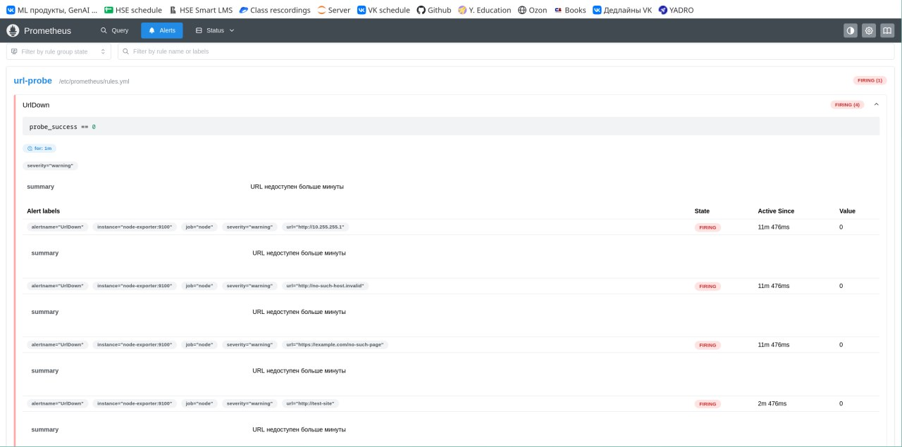

# BONUS-HW. url-probe по расписанию

Бонусное задание по DevOps-2.

Нужно было упаковать готовый Python-скрипт url-probe в Docker, настроить проверки сайтов раз в минуту и добавить мониторинг через Prometheus.

Сам probe.py не менял, только добавил Dockerfile, cron, Compose и конфигурацию мониторинга.

Команды и результаты проверок находятся в [журнале выполнения](logs/terminal.md).

## Что используется

- Python 3.12 Alpine
- Docker и Docker Compose
- BusyBox cron
- Node Exporter 1.9.1
- Prometheus 3.5.0
- Nginx для проверки алерта

## Запуск

Из папки BONUS-HW:

```bash
docker compose up -d
```

Проверить контейнеры:

```bash
docker compose ps
```

Посмотреть логи проверок:

```bash
docker compose logs url-probe
```

Prometheus доступен по адресу http://localhost:9091.

Использовал порт 9091, тк локальный 9090 уже был занят другим процессом. Внутри Docker Prometheus по-прежнему работает на 9090.

## Как всё работает

Cron внутри контейнера запускает probe.py каждую минуту. Скрипт читает адреса из urls.txt, проверяет их и записывает результат в файл url_probe.prom.

Node Exporter читает этот файл через textfile collector, а Prometheus каждые 15 секунд забирает метрики и проверяет правило UrlDown.

Если сайт недоступен больше минуты, алерт переходит в firing.

### Почему выбрал такую реализацию

**Docker-образ.** Взял python:3.12-alpine, тк скрипту нужна только стандартная библиотека Python, без дополнительных пакетов. Итоговый образ получился 74,7 МБ.

**Права.** Cron запускается как основной процесс контейнера, но сам probe.py выполняется от отдельного пользователя probe с UID 1000. Так скрипт не работает от root.

**Настройки.** Список URL передаётся через смонтированный каталог, а таймаут через PROBE_TIMEOUT. Поэтому адреса можно менять без пересборки образа, а список URL ещё и без перезапуска контейнера.

**Логи.** Скрипт пишет строки OK/FAIL в stderr, поэтому они видны через docker logs. Метрики при этом отдельно сохраняются в файл.

**Перезапуск.** Для контейнеров настроил restart: unless-stopped. Проверил восстановление после аварийного завершения основного процесса.

**Мониторинг.** Использовал общий Docker-том и textfile collector, тк скрипт запускается периодически и сам не поднимает HTTP-сервер для метрик.



## Ответы на вопросы

### 1. Почему textfile collector подходит для url-probe, а audit-svc лучше отдавать свой /metrics?

url-probe выполняется раз в минуту и завершается, т.е. постоянно работающего HTTP-сервера у него нет. Поэтому ему удобно просто сохранять готовые метрики в файл, который потом читает Node Exporter.

А audit-svc работает постоянно, поэтому ему логичнее отдавать текущие метрики через собственный /metrics. В этом случае Prometheus сможет получать актуальные данные прямо от сервиса.

### 2. Что будет, если cron перестанет запускать проверки, но контейнер останется жив?

В таком случае probe_success может продолжить показывать старое значение, даже если реальное состояние сайта уже изменилось. При этом up останется равным 1, тк Node Exporter продолжает отвечать Prometheus.

Такую проблему можно заметить по probe_last_run_timestamp_seconds. Эта метрика содержит время последней проверки, поэтому можно сравнивать её с текущим временем через PromQL:

```promql
time() - probe_last_run_timestamp_seconds > 180
```

Если последняя проверка была больше трёх минут назад, значит, cron или сам скрипт могли перестать нормально работать.

## Структура проекта

```text
BONUS-HW/
├── compose.yaml
├── README.md
├── url-probe/
│   ├── Dockerfile
│   ├── README.md
│   ├── probe.py
│   ├── urls.txt
│   ├── crontab
│   └── run-probe.sh
├── prometheus/
│   ├── prometheus.yml
│   └── rules.yml
└── logs/
    ├── terminal.md
    └── alert_firing.jpg
```
